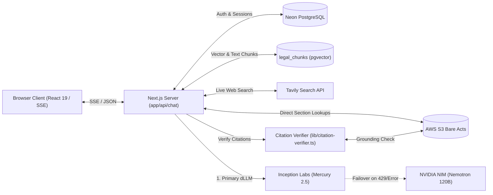

# LawBite

[](https://github.com/Pratyushhhx01/LawBite/actions/workflows/ci.yml)
[](.nvmrc)
[](https://nextjs.org/)
[](https://www.typescriptlang.org/)
[-blueviolet.svg)](https://neon.tech/)

**LawBite** is an AI-powered legal assistant engineered specifically for Indian statutory and procedural law. It bridges the gap between complex legal statutes and everyday inquiries by providing fast, conversational answers grounded directly in **157+ Indian bare acts** (including the Bharatiya Nyaya Sanhita, BNSS, BSA, IPC, CrPC, and the Constitution of India), augmented with automated statutory citation verification, document review, and multi-provider AI failover.

---

## Technical Documentation

Detailed architectural specifications, API signatures, evaluation criteria, and operational runbooks are available in the [`docs/`](docs/) directory:

- 🏛️ [**System Architecture**](docs/architecture.md) — Comprehensive architecture overview, component interactions, data flow, and Mermaid diagrams.
- ⚖️ [**Citation Verification Engine**](docs/citation-verification.md) — How legal hallucinations are prevented, section candidate extraction, and validation against primary statutory texts.
- 📚 [**Legal Knowledge Base**](docs/knowledge-base.md) — Statutory corpus structure, granular $O(1)$ section lookups, PostgreSQL `legal_chunks` hybrid retrieval, and S3 storage layout.
- 🔌 [**API Reference**](docs/api-reference.md) — Complete endpoint documentation for `/api/chat`, `/api/citations/verify`, `/api/review`, conversations, cases, and utility routes.
- 🧪 [**Testing & Benchmarking**](docs/testing.md) — Test suites, V8 coverage enforcement, legal QA benchmarks (`npm run eval:legal`), and metric definitions.
- 🚀 [**Deployment Guide**](docs/deployment.md) — Production setup on Vercel/Node.js, Neon PostgreSQL configuration, S3 permissions, and deployment smoke verification.
- 📋 [**Reviewer Evidence & Status**](docs/evidence.md) — Reviewer-facing summary of verified claims, tested paths, and known blockers.
- 🛠️ [**S3 Operational Runbook**](docs/runbook-s3.md) — Remediation steps for credential rotations, bucket access, and diagnostic checks.

---

## Problem Statement

Navigating Indian law is notoriously challenging for citizens and advocates alike:
- **Massive Criminal Law Transition:** In July 2024, India transitioned from colonial-era criminal statutes (IPC 1860, CrPC 1973, Indian Evidence Act 1872) to modern enactments (Bharatiya Nyaya Sanhita, Bharatiya Nagarik Suraksha Sanhita, and Bharatiya Sakshya Adhiniyam). Standard LLMs routinely confuse old and new section numbers.
- **Catastrophic AI Hallucinations:** Generic models frequently invent statutory section numbers or attribute offences to the wrong enactments (e.g., citing Section 302 of BNS for murder, when Section 302 covers snatching and Section 103 defines murder).
- **Prohibitive Context Overhead:** Feeding entire 500-section statutes into LLM prompts introduces extreme latency, overflows context limits, and degrades precision.

LawBite solves these problems by pairing granular section-level statutory retrieval with a deterministic **Citation Verification Engine** that checks every cited provision against primary statutory texts before showing it to the user.

---

## Key Features

- **Grounded Statutory Retrieval (157+ Bare Acts):** Instant retrieval across modern criminal codes (BNS, BNSS, BSA), historical codes (IPC, CrPC), Constitutional provisions, and commercial/civil enactments.
- **Automated Citation Verification:** Citations generated in model responses are parsed in real time and verified against official bare acts. Each reference is visually badged (`Verified`, `Not found in named act`, or `Uncheckable`).
- **Diffusion-Powered Low Latency:** Powered by **Mercury 2.5** from Inception Labs (a diffusion LLM that denoises output tokens in parallel), achieving typical end-to-end responses in ~0.8–1.5 seconds.
- **Multi-Provider Automatic Failover:** If Inception Labs encounters rate limits (HTTP 429) or timeouts, the request transparently fails over to **NVIDIA NIM** (`nvidia/nemotron-3-super-120b-a12b` $\rightarrow$ `lightning-30b` $\rightarrow$ `muse-glimmer-30b`).
- **Specialized Conversation Modes:**
  - **Default Chat:** Concise 2-line direct answers.
  - **Deep Analysis:** Structured 10–12 line breakdowns with statutory comparison tables.
  - **Talk to AI:** Conversational legal guidance with streaming Markdown.
  - **AI Lawyer (Grill):** Interactive cross-examination mode asking probing procedural questions.
  - **Document Drafter / Reviewer:** Drafts legal notices and analyzes uploaded agreements/PDFs for legal risks.
- **Real-Time Legal Web Search:** Augments answers with recent case judgments, government circulars, and amendments via the Tavily Search API.
- **Read-Only Consultation Sharing:** Authenticated users can share consultation snapshots via unique links (`/shared/<id>`), allowing recipients to import conversations into their own history idempotently.

---

## Technology Stack

| Layer | Technologies |
| :--- | :--- |
| **Frontend** | [Next.js 16](https://nextjs.org/) (App Router), [React 19](https://react.dev/), [Tailwind CSS 4](https://tailwindcss.com/) |
| **Backend & Routing** | Next.js Server Handlers, Server-Sent Events (SSE) streaming transport |
| **Authentication** | [Better Auth](https://www.better-auth.com/) with PostgreSQL adapter, OAuth 2.0 (Google, GitHub) |
| **Database & ORM** | PostgreSQL on [Neon](https://neon.tech/), [Kysely](https://kysely.dev/) query builder, `pg` connection pool |
| **Knowledge Base & Search**| AWS S3 (`@aws-sdk/client-s3`), PostgreSQL `legal_chunks` (`pgvector` + `tsvector`), Tavily API |
| **Primary AI Inference** | [Inception Labs](https://inceptionlabs.ai/) (Mercury 2.5 dLLM) with mode-specific reasoning tiers |
| **Fallback & Vision AI** | [NVIDIA NIM](https://build.nvidia.com/) (Nemotron-3 Super 120B, Nemotron-3.5 Lightning, Llama 3.2 90B Vision) |
| **Document Processing** | `pdf-parse`, `mammoth` (docx), `docx`, `jspdf` |
| **Testing & CI** | [Vitest 4](https://vitest.dev/) (V8 coverage), GitHub Actions CI pipeline |

---

## System Architecture Overview



For the comprehensive architectural breakdown and module boundaries, see [`docs/architecture.md`](docs/architecture.md).

---

## Installation & Local Setup

### Prerequisites
- **Node.js:** `>= 20.9.0` (managed via `.nvmrc`)
- **Package Manager:** `npm` (lockfile v3)
- **PostgreSQL Database:** Neon instance with `vector` extension enabled
- **API Keys:** At least one AI provider key (`INCEPTION_API_KEY` or `NVIDIA_API_KEY`)

### Quickstart

1. **Clone the repository:**
   ```bash
   git clone https://github.com/Pratyushhhx01/LawBite.git
   cd LawBite
   ```

2. **Install dependencies:**
   ```bash
   npm install
   ```

3. **Configure Environment Variables:**
   ```bash
   cp .env.example .env.local
   ```
   Edit `.env.local` with your database credentials and API keys.

4. **Run Database Migrations (PostgreSQL & pgvector):**
   ```bash
   node scripts/migrate-legal-kb.mjs
   ```

5. **Start the Development Server:**
   ```bash
   npm run dev
   ```
   Open [http://localhost:3000](http://localhost:3000) in your browser.

---

## Environment Variables

| Variable | Required? | Purpose |
| :--- | :---: | :--- |
| `DATABASE_URL` | **Yes** | Neon PostgreSQL connection string (`?sslmode=require`). |
| `BETTER_AUTH_SECRET` | **Yes** | 32-byte secret for session tokens (`openssl rand -base64 32`). |
| `BETTER_AUTH_URL` | **Yes** | Server URL (`http://localhost:3000` locally). |
| `NEXT_PUBLIC_APP_URL` | **Yes** | Canonical public origin for share links. |
| `GOOGLE_CLIENT_ID` / `_SECRET` | **Yes** | Google OAuth credentials for user login. |
| `GITHUB_CLIENT_ID` / `_SECRET` | **Yes** | GitHub OAuth credentials for user login. |
| `INCEPTION_API_KEY` | Recommended | Primary AI provider (Mercury 2.5 diffusion LLM). |
| `NVIDIA_API_KEY` | Recommended | Fallback AI provider and vision document reviewer. |
| `AWS_REGION` | Optional | AWS region for statutory S3 storage (e.g. `ap-south-1`). |
| `AWS_ACCESS_KEY_ID` | Optional | IAM key with read-only access to bare acts. |
| `AWS_SECRET_ACCESS_KEY` | Optional | IAM secret for bare acts storage. |
| `S3_BUCKET_NAME` | Optional | S3 bucket name (default: `lawbite-app-storage`). |
| `TAVILY_API_KEY` | Optional | API key for live Indian legal web search. |

For detailed configuration options and optional tuning parameters, see [`docs/deployment.md`](docs/deployment.md).

---

## Testing & Quality Assurance

LawBite includes a test suite with 30+ test files and 600+ automated test assertions:

```bash
# Run unit and route tests
npm test

# Run tests in watch mode
npm run test:watch

# Run tests with V8 coverage enforcement
npm run test:coverage

# Run TypeScript typecheck
npm run typecheck

# Run ESLint validation
npm run lint

# Check for dependency vulnerabilities
npm run audit

# Diagnose S3 bare acts connectivity
npm run check:s3

# Run the legal accuracy benchmark
npm run eval:legal
```

See [`docs/testing.md`](docs/testing.md) for full benchmark documentation, coverage thresholds, and evaluation datasets.

---

## Security & Privacy

LawBite enforces a zero-trust, defense-in-depth security model:
- **Strict HTTP Headers:** Centrally configured via `lib/security-headers.ts` (HSTS preload, `X-Frame-Options: DENY`, `X-Content-Type-Options: nosniff`, COOP `same-origin`).
- **Server-Side Secret Isolation:** AI keys, S3 credentials, database URLs, and auth secrets are isolated server-side and never exposed to the client bundle.
- **Transient Document Processing:** Files uploaded for document review (`/api/review`) are processed in transient request memory scope and are never written to the public knowledge base bucket.
- **In-Memory Rate Limiting:** Sliding-window rate limiting guards chat and verification routes against abuse and denial-of-wallet vectors.
- **Zero-Vulnerability Posture:** `npm run audit` runs on every pull request, enforcing zero high or critical advisories.

For further security details, see [`docs/security.md`](docs/security.md).

---

## Known Limitations

- **Legal Advice Disclaimer:** LawBite is an informational AI legal assistant and does not constitute formal legal representation or an attorney-client relationship. Responses should always be verified by an advocate before filing in court.
- **S3 Connectivity Dependency:** If S3 credentials are unavailable, the assistant falls back to database or internal grounding, explicitly marking citations as `Uncheckable` rather than claiming verification.
- **Draft Benchmark Status:** The 50 questions in `benchmarks/legal-qa.jsonl` serve as an engineering regression test and are marked `draft` pending formal advocate review sign-off.

---

## Future Roadmap

- [ ] Complete formal advocate review for all benchmark dataset questions.
- [ ] Expand hybrid dense vector indexing across all regional High Court judgments.
- [ ] Implement bilingual chat support (Hindi and regional Indian languages).
- [ ] Add court filing packet generator for district and High Court e-filing portals.
- [ ] Split `ChatApp.tsx` client component into modular UI components (composer, message list, citations strip).

---

## Contributing

Contributions are welcome! Please adhere to the following workflow:

1. Fork the repository and create a feature branch (`git checkout -b feature/amazing-feature`).
2. Verify all checks pass locally:
   ```bash
   npm run typecheck
   npm run lint
   npm test
   npm run audit
   ```
3. Commit your changes with clear, descriptive commit messages.
4. Push to your branch and open a Pull Request.

---

## License

LawBite is currently maintained as an open-source project. If a formal open-source license (such as MIT or Apache 2.0) is added to the repository, its terms will apply here.
