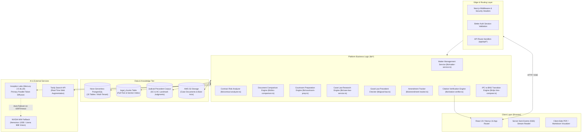
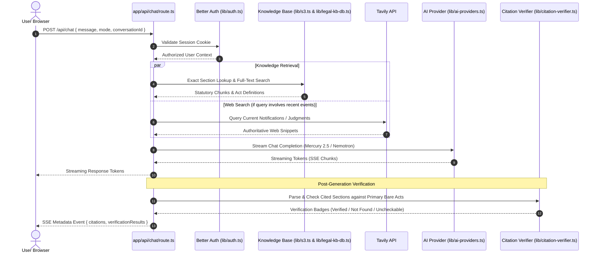

# LawBite System Architecture

This document provides a comprehensive technical breakdown of the LawBite platform architecture, component relationships, data flow pipelines, and infrastructural boundaries.

---

## 1. High-Level Architecture Overview

LawBite is designed as a hybrid deterministic-probabilistic platform for Indian legal research and legal-matter workflows. While generative AI models excel at summarization and synthesis, Indian legal practice demands exact statutory section citations, accurate enactment attribution, and verifiable judicial precedents.

To solve this, LawBite decouples legal text retrieval and verification from model inference:
1. **Primary Retrieval & Grounding:** Authoritative bare act sections and judicial records are fetched from deterministic knowledge bases (PostgreSQL `legal_chunks` and AWS S3).
2. **AI Inference:** Parallel diffusion models (Inception Labs Mercury 2.5) synthesize structured legal analysis using mode-specific reasoning tiers, backed by automated failover to NVIDIA NIM.
3. **Deterministic Verification:** Generated citations are parsed in real time and verified against official Bare Acts and judicial treatment ledgers before presentation to the user.

---

## 2. Request Data Flow (Chat & Legal Analysis)

When a user submits a legal inquiry, the request executes through the following sequence:

---

## 3. Core Component Subsystems

### 3.1 Legal Matter Management Subsystem
- **Purpose:** Full lifecycle workspace for legal disputes, litigations, and arbitrations.
- **Components:**
  - `case_folder`: Persistent database entity tracking stage (`Pre-litigation`, `Pleadings`, `Evidence`, `Arguments`, `Judgment/Decree`, `Appeal`, `Closed`), priority, court forum, next hearing date, and parties.
  - `case_document`: Versioned document tracking supporting file increments and multi-format storage (PDF, DOCX, data URI fallback).
  - `matter_activity`: Append-only audit log recording every user action, upload, status shift, and analysis run.
  - `matter_report`: Linked repository of AI-generated contract risk reports, document comparisons, and courtroom strategy briefs.
- **Security:** Strict tenant isolation guarantees that users can only access and modify matters where `userId == session.user.id`.

### 3.2 Advanced Contract Risk Analyzer
- **Purpose:** Identifies dangerous covenants, ambiguous liabilities, and missing statutory safeguards.
- **Workflow:**
  1. **Clause Extraction:** AST and legal pattern segmentation decomposes unstructured contract text into numbered clauses and titled sections.
  2. **Risk Rule Engine:** Evaluates text against Indian statutory grounds:
     - Section 27, Indian Contract Act, 1872 (Restraint of Trade / post-termination covenants).
     - Section 74, Indian Contract Act, 1872 (Liquidated damages vs unliquidated penalties).
     - Section 28, Indian Contract Act, 1872 (Bar on legal proceedings).
     - Sections 15 & 16, MSMED Act, 2006 (Delayed payment ceiling of 45 days).
     - Specific Relief Act, 1963 (Unilateral termination without cure).
  3. **Severity Grading:** Categorizes risks into `Critical`, `High`, `Medium`, and `Low`.
  4. **Alternative Clause Generator:** Suggests balanced, enforceable wording under Indian legal standards.

### 3.3 Document Comparison Engine
- **Purpose:** Deterministic side-by-side comparison between contract drafts or versions.
- **Workflow:**
  1. Aligns clauses between Document A and Document B via header identity and fuzzy similarity.
  2. Identifies additions, deletions, and modifications.
  3. Classifies modifications into legal categories: `liability_indemnity`, `payment_terms`, `penalties_damages`, `dates_deadlines`, `obligations_covenants`, `general_text`.
  4. Explains the practical commercial and legal significance of every change.

### 3.4 Courtroom Preparation Mode
- **Purpose:** Trial strategy builder for advocates and litigators.
- **Workflow:**
  1. Frames core triable legal controversies from dispute facts.
  2. Synthesizes bilateral arguments for Petitioner/Plaintiff and Respondent/Defendant, highlighting procedural vulnerabilities.
  3. Integrates verified Supreme Court authorities with verified Good-Law status.
  4. Anticipates judicial inquiries likely to be posed by the Bench.
  5. Formulates tactical witness cross-examination questions and statutory evidence checklists (e.g., Section 63 BSA electronic records certificates).

### 3.5 Statutory Amendment Tracker
- **Purpose:** Tracks major legislative transitions in Indian law.
- **Corpus:** Covers modern replacements (Bharatiya Nyaya Sanhita, BNSS, BSA) alongside major statutory amendments (Specific Relief Amendment Act 2018, NI Act Amendment 2018, Consumer Protection Act 2019, DPDP Act 2023).
- **Metadata:** Preserves Gazette of India notification numbers, enactment dates, enforcement dates, original vs amended comparative texts, and litigator practice notes.

---

## 4. Technology Stack Justification

| Technology | Role in LawBite | Architectural Reason |
| :--- | :--- | :--- |
| **Next.js 16 (App Router)** | Full-stack platform & API routes | Server-side rendering for SEO, native Server-Sent Events (SSE) streaming support, and edge middleware. |
| **React 19** | Component framework | Seamless streaming transitions, server actions, and modern hook lifecycle. |
| **PostgreSQL (Neon)** | Primary transactional & RAG database | Serverless PostgreSQL with pgvector support, connection pooling, and strict ACID transaction safety. |
| **Kysely** | Type-safe SQL query builder | Compiles zero-overhead, fully parameterized SQL queries, eliminating SQL injection risks while ensuring TypeScript compile-time schema safety. |
| **Inception Labs (Mercury 2.5)** | Primary diffusion LLM | Generates tokens in parallel through diffusion denoising, cutting time-to-first-token (TTFT) to ~1.2s without autoregressive bottleneck. |
| **NVIDIA NIM** | AI inference fallback | High-throughput enterprise fallback (`nemotron-3-super-120b`, `llama-3.2-90b-vision`) on rate limit or timeout. |
| **Better Auth** | Authentication framework | Multi-provider OAuth 2.0 (Google, GitHub) with secure database-backed session management. |
| **Tavily Search API** | Live legal web research | Curates real-time statutory amendments, circulars, and judgments from official portals (`sci.gov.in`, `indiacode.nic.in`). |
| **Vitest 4** | Automated test suite | High-performance node-based test runner with V8 coverage enforcement covering 712+ platform tests. |
