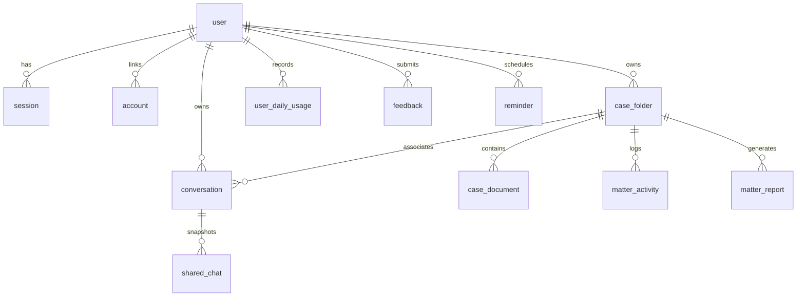

# LawBite Database Architecture & Schema

This document outlines the PostgreSQL schema, table relationships, Kysely query models, multi-tenant isolation, indexing, and connection management used in LawBite.

---

## 1. Database Overview

LawBite uses **PostgreSQL on Neon** (Serverless PostgreSQL) connected via connection pooling (`pg.Pool`) and queried using **Kysely**, a type-safe SQL query builder for TypeScript.

- **Host Platform:** Neon Serverless PostgreSQL
- **Connection Configuration:** SSL enabled (`rejectUnauthorized: false` for managed serverless connections)
- **Runtime Library:** Kysely with PostgreSQL dialect (`lib/db.ts`)
- **Total Tables:** 15 active tables



---

## 2. Table Schemas & Definitions

### 2.1 Core Authentication Tables (Better Auth)
- **`user`**: Stores user identity, email, name, avatar, email verification, and timestamps.
- **`session`**: Active login sessions with token hash, expiration timestamp, user agent, and IP address.
- **`account`**: OAuth provider accounts (Google, GitHub) linked to user ID.
- **`verification`**: Email verification tokens and password reset states.

### 2.2 Matter Management & Case Workspaces
- **`case_folder`**: Legal matter entities.
  - `id` (text, primary key)
  - `userId` (text, foreign key $\rightarrow$ `user(id)`)
  - `name` (varchar 120, title of matter)
  - `description` (varchar 2000, dispute overview)
  - `status` (`active`, `archived`, `pending`, `closed`)
  - `stage` (`Pre-litigation`, `Pleadings`, `Evidence`, `Arguments`, `Judgment/Decree`, `Appeal`, `Closed`)
  - `priority` (`Low`, `Medium`, `High`, `Urgent`)
  - `matterType` (varchar 120, e.g. "Commercial Dispute", "Arbitration")
  - `parties` (varchar 1000, plaintiff/defendant names)
  - `court` (varchar 500, forum/bench name)
  - `nextHearing` (timestamp with time zone)
  - `notes` (varchar 5000, practitioner notes)
  - `createdAt`, `updatedAt`

- **`case_document`**: Versioned documents linked to a matter.
  - `id` (text, primary key)
  - `caseId` (text, foreign key $\rightarrow$ `case_folder(id) ON DELETE CASCADE`)
  - `userId` (text, foreign key $\rightarrow$ `user(id)`)
  - `fileName` (text, original file name)
  - `fileType` (text, extension / mime)
  - `fileUrl` (text, S3 URL or base64 data URI)
  - `version` (integer, version counter)
  - `docType` (text, e.g. "Contract", "Pleading", "Evidence")
  - `fileSize` (integer, bytes)
  - `createdAt`

- **`matter_activity`**: Audit trail for matter events.
  - `id` (text, primary key)
  - `matterId` (text, foreign key $\rightarrow$ `case_folder(id) ON DELETE CASCADE`)
  - `userId` (text)
  - `activityType` (varchar 64, e.g. `created`, `updated`, `document_uploaded`, `report_saved`)
  - `description` (text, human-readable summary)
  - `metadata` (jsonb, event payload)
  - `createdAt`

- **`matter_report`**: Persistent AI reports attached to matters.
  - `id` (text, primary key)
  - `matterId` (text, foreign key $\rightarrow$ `case_folder(id) ON DELETE CASCADE`)
  - `userId` (text)
  - `reportType` (varchar 64, `contract_risk`, `document_comparison`, `courtroom_prep`)
  - `title` (text, report headline)
  - `summary` (text, executive briefing)
  - `reportData` (jsonb, complete structured output)
  - `createdAt`

### 2.3 Conversations & Sharing
- **`conversation`**: Chat sessions and consultation transcripts.
  - `id` (text, primary key)
  - `userId` (text, foreign key $\rightarrow$ `user(id)`)
  - `title` (text, conversation summary)
  - `preview` (text, snippet)
  - `type` (varchar 32, `chat`, `analysis`, `talk-to-ai`, `grill`, `draft`, `review`)
  - `pinned` (boolean)
  - `folderId` (text, optional foreign key $\rightarrow$ `case_folder(id)`)
  - `messages` (jsonb, array of message objects)
  - `createdAt`, `updatedAt`

- **`shared_chat`**: Immutable public snapshots of shared consultations.
  - `id` (text, primary key)
  - `conversationId` (text, foreign key $\rightarrow$ `conversation(id)`)
  - `userId` (text, creator)
  - `title` (text)
  - `messages` (jsonb)
  - `createdAt`

### 2.4 Legal Knowledge Retrieval
- **`legal_chunks`**: High-speed statutory chunk and search cache.
  - `id` (text, primary key)
  - `act_id` (varchar 120, normalized statute identifier)
  - `provision` (varchar 64, e.g. "Section 302", "Article 21")
  - `title` (text, section heading)
  - `content` (text, statutory wording)
  - `search_vector` (`tsvector`, generated column for full-text search)

---

## 3. Multi-Tenant Data Isolation Strategy

Data privacy is vital for legal software. LawBite enforces tenancy guarantees at both the database and service layers:

1. **Compulsory `userId` Filters:** Every select, update, and delete query on user-owned entities (`case_folder`, `case_document`, `conversation`, `matter_report`, `matter_activity`) explicitly binds the session's authenticated `user.id`.
2. **Foreign-Key Ownership Checks:** In [`lib/matter-service.ts`](file:///c:/Users/medev/Desktop/LawBite/lib/matter-service.ts), attempting to attach documents or reports to a `matterId` verifies that the folder is owned by `userId` before executing an insert:
   ```ts
   const folder = await db
     .selectFrom("case_folder")
     .select("id")
     .where("id", "=", matterId)
     .where("userId", "=", userId)
     .executeTakeFirst();
   if (!folder) throw new Error("Matter not found or unauthorized");
   ```
3. **Cascading Deletions:** Deleting a legal matter safely cascades to delete its associated activities, documents, and reports, while detaching conversations by setting `folderId = NULL`.
