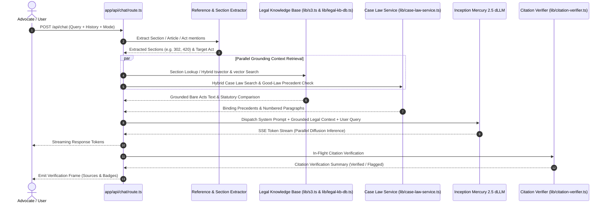

# LawBite RAG & Statutory Retrieval Architecture

This document details the multi-tier Retrieval-Augmented Generation (RAG) pipeline powering LawBite's legal intelligence platform.

---

## 1. High-Level Retrieval Workflow



---

## 2. Multi-Tier Retrieval Hierarchy

To balance millisecond latency against comprehensive legal recall, LawBite uses a 4-tier retrieval fallback:

```
Tier 1: O(1) In-Memory LRU Cache (sec:{act}:{section})
   │
   ├─► Hit: Return provision instantly (<1ms)
   │
   └─► Miss: Tier 2
         │
Tier 2: PostgreSQL legal_chunks (Exact Provision & tsvector Search)
   │
   ├─► Hit: Return provision + rank (5–15ms)
   │
   └─► Miss: Tier 3
         │
Tier 3: Local Filesystem Knowledge Base (knowledge-base/bare-acts/*)
   │
   ├─► Hit: Return structured section JSON (2–8ms)
   │
   └─► Miss: Tier 4
         │
Tier 4: Remote AWS S3 Bucket (lawbite-app-storage)
   │
   └─► Return Bare Act JSON or Full Text (80–180ms)
```

---

## 3. Statutory Transition Mapping (2024 Overhaul)

When a query cites a criminal section subject to the 1 July 2024 legal transition, the pipeline automatically augments the context with cross-code equivalents:

1. **IPC $\leftrightarrow$ BNS Comparison:**
   - Retrieves old section text (IPC 1860).
   - Retrieves new section text (BNS 2023).
   - Injects wording differences, penal changes, and the constitutional temporal applicability rule (Article 20(1) Constitution of India).
2. **CrPC $\leftrightarrow$ BNSS Comparison:**
   - Injects procedural shifts (e.g., electronic summons, preliminary inquiry guidelines).
3. **Evidence Act $\leftrightarrow$ BSA Comparison:**
   - Injects electronic records certificate rules (Section 63 BSA replacing Section 65B IEA).

---

## 4. Case-Law & Good-Law Judicial Treatment

Unlike generic search that dumps entire judgments into context, the Case Law Engine:
- Indexes numbered paragraphs to preserve exact judicial citations (e.g. `[Para 42]`).
- Performs Good-Law status checking via `lib/good-law.ts`:
  - **Good Law:** Confirms the decision is binding precedent with verified subsequent treatments.
  - **Overruled Precedent:** Flags the overruling court, overruling case citation, and overruling ground, instructing the model never to cite it as good law.

---

## 5. In-Flight Citation Verification

Citations are parsed using structured regular expressions covering all Indian central and state legislation patterns. Each candidate is tested against primary Bare Act provisions and assigned an authentic verification status:

- `verified`: Section exists in the primary statutory enactment.
- `section_not_found`: Statute exists, but the referenced section is out of range.
- `act_not_resolved`: Name does not map to a recognized Indian statute.
- `untrusted_web_source`: Cited web link is not on the trusted legal source whitelist.
