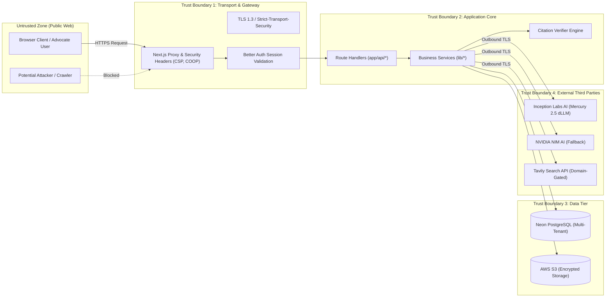

# LawBite Comprehensive Threat Model & Security Architecture

**Evaluation Standard:** Production Legal Technology SaaS Security Assessment  
**Methodology:** STRIDE (Spoofing, Tampering, Repudiation, Information Disclosure, Denial of Service, Elevation of Privilege)  
**Last Updated:** November 2026  
**Scope:** Frontend Application, Next.js API Route Handlers, Database Layer (Neon PostgreSQL), S3 Object Storage, AI Provider Gateway, and Third-Party Search.

---

## 1. System Assets & Sensitivity Classification

| Asset | Sensitivity | Storage Location | Protection Mechanisms |
| :--- | :---: | :--- | :--- |
| **User Identity & Passwords** | Critical | Neon PostgreSQL (`user`, `account`, `session`) | Scrypt/Bcrypt hashing via Better Auth, secure HTTP-only cookies, OAuth 2.0 PKCE |
| **Litigation Matters & Strategy Notes** | High | Neon PostgreSQL (`case_folder`, `matter_activity`) | Explicit SQL tenant isolation (`WHERE "userId" = session.user.id`) |
| **Case Documents & Contracts** | High | AWS S3 (`cases/{userId}/{caseId}/...`) | User-scoped object prefixes, MIME-type whitelisting, filename sanitization, pre-signed access |
| **Private Chat Conversations** | High | Neon PostgreSQL (`conversation`) | User ID binding, isolated share snapshot exports (`shareRecordId`) |
| **API Secrets & Keys** | Critical | Environment variables (`.env.local` / Vercel Vault) | Server-side only; excluded from client bundles; zero logging of credentials |
| **Statutory Knowledge Base** | Public | PostgreSQL (`legal_chunks`) & AWS S3 (`bare-acts/*`) | Read-only IAM access, hash integrity validation |

---

## 2. Trust Boundaries & Data Flow

---

## 3. STRIDE Threat Analysis & Implemented Mitigations

### 1. Spoofing (Identity & Authentication)
- **Threat:** Attacker attempts session hijacking or brute-forcing user credentials.
- **Mitigations Implemented:**
  - Standardized authentication via Better Auth with secure session tokens (`session.token` with 7-day expiration).
  - Session cookies configured with `HttpOnly`, `SameSite=Lax`, and `Secure` flags in production.
  - Social OAuth (Google, GitHub) delegates credential storage to trusted identity providers.
  - Admin endpoints (`/api/admin`) verify both valid session AND strict membership in `ADMIN_EMAILS` with default-deny behavior.

### 2. Tampering (Data Integrity)
- **Threat:** Attacker modifies case documents, modifies statutory texts, or injects malicious payloads into legal drafts.
- **Mitigations Implemented:**
  - SQL parameterization via Kysely completely eliminates SQL injection risks.
  - Strict input validation on all file uploads (rejects executables, HTML, JavaScript).
  - In-flight document comparison hashes and diff algorithms verify modifications between contract versions.
  - Statutory knowledge base is read-only at runtime; bare acts are validated against Gazette references.

### 3. Repudiation
- **Threat:** User claims an action was taken by the platform or denies sending a formal legal notice.
- **Mitigations Implemented:**
  - Every legal notice sent via `/api/notices` logs `sentAt`, `recipientEmail`, `subject`, and sender ID.
  - Matter activity log (`matter_activity`) records timestamped audit trails of document additions, status changes, and report links.
  - Every AI response generated is stamped with conversation metadata and citation verification summaries.

### 4. Information Disclosure
- **Threat:** Insecure Direct Object Reference (IDOR) leaking other users' cases, contracts, or consultations.
- **Mitigations Implemented:**
  - Every database query without exception checks `.where("userId", "=", user.id)`.
  - Document fetching in `/api/cases/documents/[docId]` requires `userId` matching.
  - Shared chats (`/shared/[id]`) generate an independent, read-only snapshot row (`share-UUID`) containing only public messages; original conversation IDs and user IDs are never exposed.
  - AI prompt construction strips sensitive credentials and cross-user context.

### 5. Denial of Service (DoS & Resource Exhaustion)
- **Threat:** Attacker submits massive files, issues recursive search queries, or exhausts serverless connection pools.
- **Mitigations Implemented:**
  - File upload ceiling enforced strictly at 10MB; text extraction truncated to 15,000 characters.
  - Consolidated single PostgreSQL connection pool (`Pool` with max 10 connections) shared between Kysely and `legal-kb-db.ts`.
  - RAG section retrieval parallelized with bounded candidate sets (eliminates sequential 157-act scanning loops).
  - Rate-limit retry policies with exponential backoff (`300ms`, `800ms`, `1600ms`) prevent runaway client request storms.

### 6. Elevation of Privilege
- **Threat:** Standard user gains access to administrative dashboard or modifies platform knowledge base.
- **Mitigations Implemented:**
  - Strict role/email gating on `/admin` and `/api/admin`. If `ADMIN_EMAILS` is empty or unconfigured, access returns HTTP 403 Forbidden.
  - Database credentials use a restricted user role with zero DDL privileges outside controlled migrations.

---

## 4. AI-Specific Threat Mitigations

1. **Prompt Injection & Adversarial Jailbreaking:**
   - System prompts define immutable identity as an Indian legal information assistant.
   - Refusal boundaries intercept requests for illegal conduct, evasion of law, or out-of-jurisdiction tasks.
   - Untrusted web search content from Tavily is domain-filtered to official legal portals (`ecourts.gov.in`, `sci.gov.in`, `indiankanoon.org`) and stripped of executable tags.
2. **Hallucination Exploitation:**
   - Decoupled citation verification independently verifies sections against primary Bare Acts text.
   - Any hallucinated section is tagged with `section_not_found` warning notices.
