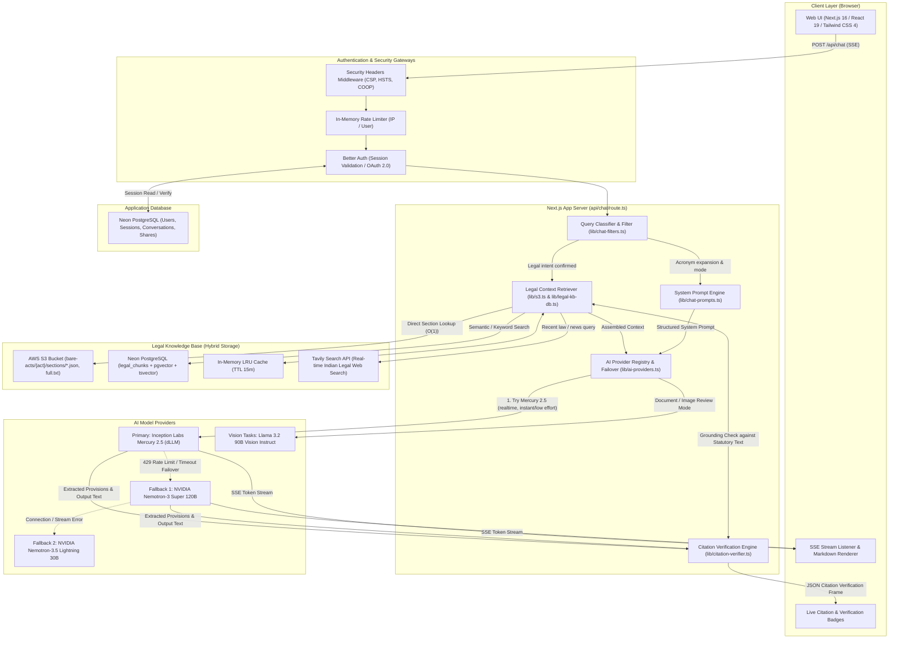

# System Architecture

LawBite is an AI-powered legal assistant tailored for Indian statutory and procedural law. It is architected as a Next.js (App Router) full-stack application featuring server-orchestrated retrieval-augmented generation (RAG), statutory citation verification, multi-provider LLM failover, and zero-trust security hardening.

---

## High-Level Architecture Diagram

The following diagram illustrates the end-to-end request lifecycle across the client, authentication layer, server orchestration, knowledge retrieval layers, AI inference providers, and citation verification:

---

## Component Breakdown

### 1. Client Layer
- **Framework:** Next.js 16 (App Router) with React 19 and Tailwind CSS 4.
- **Chat Interface (`app/chat/_components/ChatApp.tsx`):**
  - Connects to `/api/chat` using standard Server-Sent Events (SSE).
  - Handles streaming token decoding, incremental Markdown rendering, auto-scrolling, and attachment uploads (PDFs/images).
  - Renders citation badges (`Verified`, `Not found in named act`, `Uncheckable`) alongside statutory provisions as verification events arrive.
  - Implements UI modes: **Default Chat** (concise 2-line direct answers), **Deep Analysis** (structured 10–12 line breakdown with table repair), **Talk to AI** (conversational legal guidance), **AI Lawyer (Grill)** (structured interrogation/cross-examination), and **Document Review / Drafter**.

### 2. Authentication & Security Middleware
- **Session Authentication (`lib/auth.ts`, `lib/auth-client.ts`):**
  - Powered by Better Auth with OAuth 2.0 providers (Google and GitHub).
  - All protected endpoints (`/api/chat`, `/api/review`, `/api/conversations`, `/api/user/profile`) enforce cryptographic session verification on incoming request headers.
  - Session verification responses from PostgreSQL are cached in-memory for 60 seconds to eliminate redundant database round-trips during rapid chat interactions.
- **HTTP Hardening (`lib/security-headers.ts`):**
  - Injects strict security headers: HSTS (2 years with subdomains), clickjacking protection (`X-Frame-Options: DENY`, `frame-ancestors 'none'`), `X-Content-Type-Options: nosniff`, Cross-Origin Opener Policy (`same-origin`), and device hardware lockdowns (`camera=()`, `microphone=()`, `geolocation=()`).
- **Rate Limiting & Request Guards:**
  - Route-level sliding-window rate limiters cap requests per IP/user (e.g., 30 requests/min for chat, 60 requests/min for citation verifications).
  - Enforces payload bounds: max 100 messages per conversation, max 10,000 characters per message.

### 3. Core Chat Orchestration (`app/api/chat/route.ts`)
The chat API route acts as a pure coordinator and does not couple prompt text or statutory mappings into the transport logic:
1. **Query Classification (`lib/chat-filters.ts`):**
   - Classifies input into legal vs. non-legal, Indian jurisdiction vs. foreign jurisdiction, and expands statutory abbreviations (e.g., expanding IPC, CrPC, BNS, BNSS, BSA, CPC, DPDP, POSH).
   - Enforces refusal boundaries for non-Indian or non-legal queries.
2. **Context Retrieval (`lib/s3.ts` & `lib/legal-kb-db.ts`):**
   - Resolves target statutes from `lib/act-map.ts`.
   - Fetches statutory text concurrently via direct statutory lookup or hybrid search.
   - Triggers real-time web search via Tavily if recent legal news or unindexed precedents are requested.
3. **Prompt Construction (`lib/chat-prompts.ts`):**
   - Assembles system prompts containing strict statutory grounding instructions, Indian legal context, citation format requirements, and non-hallucination constraints.
4. **AI Failover Dispatch (`lib/ai-providers.ts`):**
   - Dispatches the prompt to the provider failover engine.
5. **Streaming Transport:**
   - Pipes tokens to the client over an HTTP `text/event-stream`.
   - Concurrently processes citation candidates against the bare-act repository, flushing a final structured `citations` verification frame.

### 4. Legal Knowledge Base (Hybrid Storage Architecture)
LawBite maintains a two-tier repository of 157+ Indian bare acts:
- **AWS S3 (`bare-acts/`):**
  - Object store housing structured JSON files for individual statutory sections (`bare-acts/{act-name}/sections/{section}.json`), table-of-contents indices (`_sections.json`), and consolidated full statutory texts (`full.txt`).
  - Read-only IAM access ensures statutory records cannot be modified or deleted by application services.
- **PostgreSQL `legal_chunks` (Neon):**
  - Supports hybrid search: exact section match (`act_id` + `provision`), full-text search via PostgreSQL `tsvector` (`GIN` index on `tsv_content`), and vector similarity search via `pgvector` (`vector(768)` with HNSW index).
- **In-Memory LRU Cache:**
  - Caches up to 500 retrieved statutory sections and index manifests for 15 minutes, ensuring sub-millisecond retrieval on common queries.
- **External Web Context (Tavily):**
  - Augments answers for recent developments, circulars, notifications, and ongoing High Court/Supreme Court hearings with source whitelisting (`lib/legal-sources.ts`).

### 5. Multi-Provider AI Inference & Failover (`lib/ai-providers.ts`)
The server strictly controls model selection; the browser client cannot override or request arbitrary models:
- **Default Provider — Inception Labs (Mercury 2.5 dLLM):**
  - Mercury 2.5 uses diffusion architecture (denoising tokens in parallel rather than autoregressive sequential generation), delivering rapid response times.
  - Latency is tuned using mode-specific reasoning tiers: `instant` for quick conversational answers, `low` for deep analysis, and `medium` for document drafting.
  - Automatically sends `realtime: true` to prioritize low-latency inference.
  - Retries free-tier 429 rate limits with exponential backoff before triggering provider failover.
- **Automatic Fallback Chain — NVIDIA NIM:**
  - If Inception Labs encounters rate limits, timeouts, or network failures, the request automatically falls back through NVIDIA NIM:
    1. `nvidia/nemotron-3-super-120b-a12b` (Primary fast fallback)
    2. `nvidia/nemotron-3.5-lightning-30b-a3b` (Secondary fallback)
    3. `meta/muse-glimmer-30b` (Last-resort text fallback)
- **Vision Models:**
  - Document review requests (`/api/review`) or messages containing image attachments automatically bypass text models to use `meta/llama-3.2-90b-vision-instruct` (or `nvidia/nemotron-3.5-super-vl-120b-a12b` on failover).

### 6. Citation Verification Engine (`lib/citation-verifier.ts`)
- Automatically extracts statutory citations (e.g., "Section 103 BNS", "Article 21 Constitution") from both model output prose and structured context.
- Validates the existence and text of each cited section against the bare act corpus.
- Emits explicit verification states: `verified`, `section_not_found`, `act_not_resolved`, `section_not_parsed`, `web_source`, `untrusted_web_source`, or `lookup_error`.
- Prevents false hallucination flags by classifying storage timeouts or network failures as `lookup_error` rather than penalizing accuracy.

---

## Data Flow Summary

| Action | Transport | Protocol / Format | Target / Source |
| :--- | :--- | :--- | :--- |
| User submits chat message | HTTP POST | JSON / SSE stream | Client $\rightarrow$ `/api/chat` |
| Session check | Internal / Pool | SQL Query (`SELECT`) | `/api/chat` $\leftrightarrow$ PostgreSQL (`session`, `user`) |
| Statutory retrieval | S3 API / SQL | JSON / Text / Vector | `/api/chat` $\leftrightarrow$ AWS S3 / `legal_chunks` |
| AI Inference | HTTPS POST | OpenAI-compatible REST | App Server $\rightarrow$ Inception Labs / NVIDIA NIM |
| Token streaming | HTTP SSE | `text/event-stream` | App Server $\rightarrow$ Client |
| Citation verification | Async loop | JSON frame | App Server $\rightarrow$ Bare Acts Storage $\rightarrow$ Client |
| Document review | HTTP POST | `multipart/form-data` | Client $\rightarrow$ `/api/review` $\rightarrow$ PDF parser / OCR |
