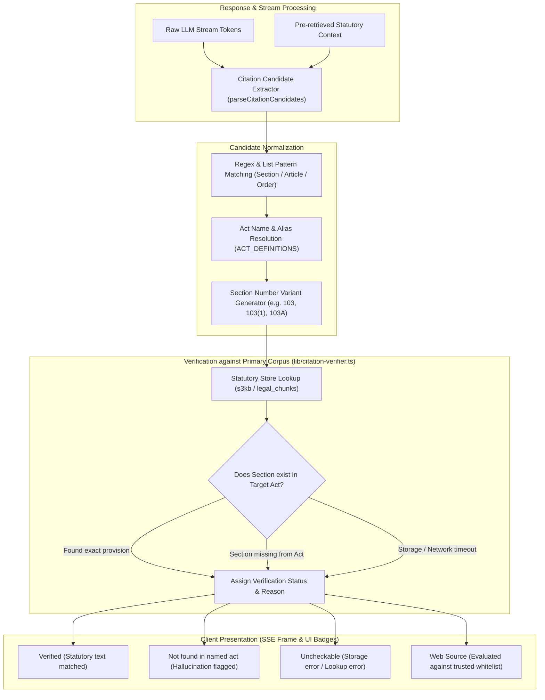

# Citation Verification Engine

One of the most dangerous failure modes of Large Language Models (LLMs) in the legal domain is hallucination: fabricating non-existent statutory section numbers, attributing offences to the wrong enactments, inventing procedural timelines, or misciting repealed statutes (such as citing IPC sections for offences committed after the Bharatiya Nyaya Sanhita came into effect).

LawBite addresses this problem through an automated **Citation Verification Engine** (`lib/citation-verifier.ts` and `lib/response-citations.ts`). Rather than trusting that an LLM's generated citations are factually accurate, LawBite parses all statutory references and verifies each section directly against authoritative primary statutory texts before annotating them in the UI.

---

## The Problem of Legal AI Hallucinations

Common hallucination failure modes in Indian legal queries include:
1. **Section Invention:** Fabricating section numbers that do not exist in the referenced enactment (e.g., citing *Section 512 BNS* when BNS terminates at Section 358).
2. **Statute Anachronism & Misattribution:** Conflating repealed provisions with modern replacements (e.g., citing *Section 302 of the Bharatiya Nyaya Sanhita* for murder, when Section 302 of BNS addresses snatching and Section 103 BNS defines murder; or confusing Section 302 of IPC with Article 302 of the Indian Constitution).
3. **Ghost Case Law & Unreliable Blogs:** Hallucinating fictional High Court citations or quoting unverified legal aggregator blogs that summarise superseded legal positions.

---

## Citation Verification Workflow

The following diagram illustrates how citations are parsed, normalized, verified against the primary statutory store, and surfaced to the user:

---

## How Citation Verification Works Internally

The verification system executes in six distinct phases:

### 1. Extraction of Citation Candidates (`parseCitationCandidates`)
Citations originate from two sources:
- **Prose Extraction (`textCandidates`):** Scans the model's emitted text for statutory expressions using regex patterns such as `/(?:section|sec\.?|§|article|art\.?|order|rule)\s*([0-9]+[A-Za-z]?(?:\s*\([0-9a-zA-Z]+\))*)/gi`. It extracts the provision number and searches a window of $\pm 140$ characters around the match to associate it with the closest cited Act name.
- **Structured Context Candidates (`structuredCandidates`):** Inspects the primary sources retrieved from the knowledge base during initial query processing.
- **Deduplication:** Merges identical section references to prevent double-counting. If a raw text reference omits the Act name (e.g., *"Section 103"*), but an existing structured candidate uniquely links Section 103 to the *Bharatiya Nyaya Sanhita*, the reference is safely consolidated.

### 2. Statutory Name & Alias Resolution (`resolveAct`)
LawBite maintains a comprehensive alias catalogue (`ACT_DEFINITIONS`) mapping official enactments, popular abbreviations, and colloquial names to standard canonical keys.
- *Examples:*
  - `"Bharatiya Nyaya Sanhita"`, `"BNS"`, `"BNS 2023"` $\rightarrow$ `bharatiya-nyaya-sanhita`
  - `"Indian Penal Code"`, `"IPC"` $\rightarrow$ `ipc`
  - `"Code of Criminal Procedure"`, `"CrPC"` $\rightarrow$ `crpc`
  - `"Constitution of India"`, `"Indian Constitution"` $\rightarrow$ `constitution`
  - `"Digital Personal Data Protection Act"`, `"DPDP Act"`, `"DPDP"` $\rightarrow$ `dpdp-act`

Aliases are matched using word-boundary regular expressions and ordered by descending length to prevent sub-string shadowing (e.g., ensuring "Indian Evidence Act" matches before "Evidence Act").

### 3. Section Variant Generation (`sectionVariants`)
Statutory references often vary in notation (e.g., "Section 103", "Section 103(1)", "Section 103A", "103a"). The generator creates candidate variants:
1. Exact input string (e.g., `103(1)`)
2. Uppercase and lowercase variations (e.g., `103A`, `103a`)
3. Base section stripped of subsections or clauses (e.g., `103`)

### 4. Direct Statutory Lookup (`verifyCandidate`)
For each statutory candidate:
1. Queries the bare-act storage (`s3kb.getSection(actKey, variant)` or Neon `legal_chunks`).
2. If found, returns the matched section number, canonical statutory title, and statutory snippet (truncated to 1,000 characters for prompt safety).
3. If not found after attempting all variants, confirms whether the Act's index itself is available:
   - If the Act's index was reachable, the section is flagged as `section_not_found`.
   - If the storage backend was unreachable, timed out, or threw an exception, it is flagged as `lookup_error`.

### 5. Web Citation Evaluation (`isTrustedLegalSource`)
For citations linking to external URLs (from Tavily search augmentation), the engine checks the domain against a strict legal whitelist (`lib/legal-sources.ts`). Official court registries (`sci.gov.in`, `delhihighcourt.nic.in`), statutory repositories (`indiacode.nic.in`, `egazette.gov.in`), and reputed legal portals (`barandbench.com`, `livelaw.in`) are marked as `web_source`, while untrusted or unverified blogs are flagged as `untrusted_web_source`.

---

## Verification Statuses & Meanings

| Status / Reason | Verified? | UI Indicator | Meaning & Diagnostic |
| :--- | :---: | :--- | :--- |
| `verified` | **Yes** | Green badge: `Verified` | The section was located in the official bare-act text and confirmed genuine. |
| `section_not_found` | **No** | Red/Amber badge: `Not found in named act` | Hallucination detected: The named Act exists, but the referenced section does not exist in that Act. |
| `act_not_resolved` | **No** | Gray badge: `Act not identified` | A section number was cited, but the text lacked sufficient context to identify the specific Act. |
| `section_not_parsed` | **No** | Gray badge: `Unparsed section` | The Act was identified, but the section number format could not be extracted cleanly. |
| `reference_not_section` | **No** | Informational | General reference citation (e.g., full Act reference or schedule) rather than a specific section. |
| `web_source` | **Yes** | Blue badge: `Trusted Web Source` | Citation comes from an authoritative legal registry or court website. |
| `untrusted_web_source` | **No** | Amber badge: `External Source` | Citation comes from a generic web domain outside the curated Indian legal whitelist. |
| `lookup_error` | **No** | Gray badge: `Uncheckable` | The storage backend (S3 / database) was unreachable or timed out. **Crucially: Not counted as a hallucination.** |

---

## Quantitative Quality Metrics

The verifier computes aggregate accuracy statistics for benchmark runs and regression testing:

$$\text{Precision} = \frac{\text{Verifiable Sections Verified}}{\text{Verifiable Sections Total}}$$

$$\text{Hallucination Rate} = 1 - \text{Precision}$$

> [!IMPORTANT]
> **Lookup Errors Do Not Count as Hallucinations:**
> If an S3 key returns `HTTP 403` or a network timeout occurs, those sections are recorded under `sectionLookupErrors` and excluded from both the numerator and denominator of `Precision`. This ensures infrastructure degradation does not artificially inflate hallucination rates or mask true model accuracy.

---

## Relevant Source Code Files

- [`lib/citation-verifier.ts`](file:///C:/Users/Pratyush/Desktop/lawbite/lib/citation-verifier.ts) — Core parsing, act resolution, section variant evaluation, and metric computation.
- [`lib/response-citations.ts`](file:///C:/Users/Pratyush/Desktop/lawbite/lib/response-citations.ts) — Real-time annotation pipeline executed alongside streaming chat completions.
- [`lib/legal-sources.ts`](file:///C:/Users/Pratyush/Desktop/lawbite/lib/legal-sources.ts) — Whitelist and domain classifier for Indian legal authority websites.
- [`lib/act-map.ts`](file:///C:/Users/Pratyush/Desktop/lawbite/lib/act-map.ts) — Master dictionary mapping 157+ Indian bare acts to standard keys.
- [`app/api/citations/verify/route.ts`](file:///C:/Users/Pratyush/Desktop/lawbite/app/api/citations/verify/route.ts) — Authenticated API endpoint for standalone citation verification.
- [`tests/citation-verifier.test.ts`](file:///C:/Users/Pratyush/Desktop/lawbite/tests/citation-verifier.test.ts) — Comprehensive unit test suite validating parsing, normalization, and verification edge cases.
