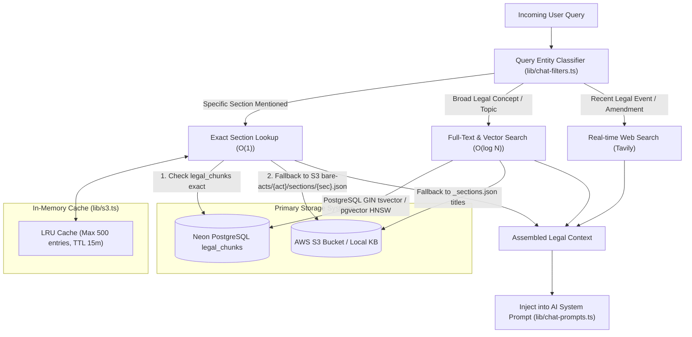

# Legal Knowledge Base & Retrieval Architecture

LawBite relies on an authoritative Indian legal corpus encompassing **157+ Indian bare acts**, constitutional provisions, statutory schedules, procedural codes, and legal reference frameworks. This document describes how the corpus is structured, stored, indexed, and retrieved at runtime.

---

## Storage Infrastructure & Hybrid Layout

LawBite utilizes a **two-tier hybrid retrieval architecture**:
1. **Primary Object Store (AWS S3) & Local Filesystem Fallback:**
   - Pre-parsed, granular JSON documents storing individual statutory sections and complete bare act texts.
   - Bucket: Configured via `S3_BUCKET_NAME` (default: `lawbite-app-storage`, region `ap-south-1`).
   - Local fallback: `knowledge-base/bare-acts/` directory in the repository for offline or local evaluation.
2. **PostgreSQL Legal Chunks Store (`legal_chunks` in Neon DB):**
   - Stores granular statutory text blocks with full-text search (`tsvector`) and dense vector embeddings (`pgvector`).



---

## Directory Organization & Corpus Structure

Statutory documents in storage follow a predictable, hierarchical layout:

```text
knowledge-base/
├── bare-acts/
│   ├── _index.json                        # Master catalog of all indexed Acts (id, title, sectionCount)
│   ├── bharatiya-nyaya-sanhita/
│   │   ├── _sections.json                 # Table of contents: section numbers and section titles
│   │   ├── full.txt                       # Full unbroken text of the enactment
│   │   └── sections/                      # Granular section JSON files
│   │       ├── 1.json
│   │       ├── 2.json
│   │       ├── 103.json                   # e.g., Punishment for murder
│   │       └── ...
│   ├── code-of-civil-procedure/
│   ├── constitution/
│   ├── indian-penal-code/
│   └── ... (157+ enactments)
├── reference/                             # Static concordance & transition tables
│   ├── bns-to-ipc.json                    # Transition mapping: BNS (2023) to IPC (1860)
│   ├── bnss-to-crpc.json                  # Transition mapping: BNSS (2023) to CrPC (1973)
│   ├── bsa-to-iea.json                    # Transition mapping: BSA (2023) to Evidence Act (1872)
│   ├── court-hierarchy.json               # Indian civil & criminal appellate hierarchy
│   ├── limitation-periods.json            # Statutory limitation table (Limitation Act)
│   └── bailable-offenses.json             # Classification of bailable vs non-bailable offences
└── templates/                             # Standard legal notice drafts & formats
```

### Granular Section JSON Schema
Each statutory section JSON (`sections/{section}.json`) contains:
```json
{
  "section": "103",
  "title": "Punishment for murder",
  "text": "(1) Whoever commits murder shall be punished with death or imprisonment for life, and shall also be liable to fine.\n(2) When a group of five or more persons acting in concert commits murder on the ground of race, caste or community, sex, place of birth, language, personal belief or any other similar ground, each member of such group shall be punished with death or with imprisonment for life, and shall also be liable to fine."
}
```

---

## Retrieval Workflow & Tiering

Loading an entire 500-section statute into an LLM prompt degrades context windows, increases latency, and introduces prompt confusion. LawBite applies a **three-tier retrieval strategy**:

### Tier 1: Exact Provision Retrieval ($O(1)$)
When a query references an explicit statutory provision (e.g., *"Section 103 BNS"* or *"Article 21 Constitution"*):
1. `lib/chat-filters.ts` and `lib/act-map.ts` identify the Act key (`bharatiya-nyaya-sanhita`) and section number (`103`).
2. The system checks the in-memory LRU cache (`sec:bharatiya-nyaya-sanhita:103`).
3. If not cached, it queries the database (`lookupSectionExact` in `lib/legal-kb-db.ts`).
4. If not found in the database, it performs a direct object fetch against S3 / local filesystem (`bare-acts/bharatiya-nyaya-sanhita/sections/103.json`).
5. Only the concise 1–2 KB statutory provision is returned and injected into the prompt.

### Tier 2: Keyword & Concept Retrieval
When the query does not mention a specific section (e.g., *"anticipatory bail grounds"* or *"penalty for cheque dishonour"*):
1. The system queries PostgreSQL `legal_chunks` using PostgreSQL's native `tsvector` full-text search:
   ```sql
   SELECT act_id, provision, title, content,
          ts_rank(tsv_content, plainto_tsquery('english', $1)) as rank
   FROM legal_chunks
   WHERE tsv_content @@ plainto_tsquery('english', $1)
   ORDER BY rank DESC LIMIT 10;
   ```
2. If the PostgreSQL table is unavailable, it falls back to scanning the pre-compiled `_sections.json` metadata index across matching acts in S3.

### Tier 3: Dense Vector Similarity Retrieval (Semantic Search)
For conceptual queries where statutory terminology differs from layman phrasing:
1. Embeddings can be queried through the `searchLegalChunksVector` function in `lib/legal-kb-db.ts`.
2. Queries execute against the 768-dimensional `embedding` column indexed via HNSW:
   ```sql
   SELECT act_id, provision, title, content,
          (embedding <=> $1::vector) as distance
   FROM legal_chunks
   WHERE embedding IS NOT NULL
   ORDER BY distance ASC LIMIT 5;
   ```

---

## Database Schema (`legal_chunks`)

The database migration script (`scripts/migrate-legal-kb.mjs`) defines the following PostgreSQL table:

```sql
CREATE TABLE IF NOT EXISTS legal_chunks (
  id TEXT PRIMARY KEY,
  category VARCHAR(32) NOT NULL,            -- 'bare_act', 'case_law', 'reference'
  act_id VARCHAR(128) NOT NULL,             -- e.g. 'bharatiya-nyaya-sanhita'
  act_title TEXT NOT NULL,                  -- e.g. 'Bharatiya Nyaya Sanhita, 2023'
  provision VARCHAR(64) NOT NULL,           -- e.g. 'Section 103'
  title TEXT NOT NULL,                      -- e.g. 'Punishment for murder'
  year INTEGER,
  court VARCHAR(64),
  content TEXT NOT NULL,
  embedding vector(768),
  tsv_content tsvector GENERATED ALWAYS AS (
    to_tsvector('english', title || ' ' || content)
  ) STORED,
  created_at TIMESTAMP WITH TIME ZONE DEFAULT NOW()
);

-- Fast GIN index for text search:
CREATE INDEX IF NOT EXISTS legal_chunks_tsv_idx ON legal_chunks USING gin (tsv_content);
-- Composite index for O(1) section lookups:
CREATE INDEX IF NOT EXISTS legal_chunks_act_prov_idx ON legal_chunks (act_id, provision);
-- HNSW index for vector cosine similarity:
CREATE INDEX IF NOT EXISTS legal_chunks_embedding_hnsw 
ON legal_chunks USING hnsw (embedding vector_cosine_ops) 
WITH (m = 16, ef_construction = 64);
```

---

## Ingestion & Management Tooling

The repository provides automated Python and Node.js ingestion utilities in the `scripts/` directory:
- `scripts/migrate-legal-kb.mjs`: Creates the `legal_chunks` table, enables `pgvector`, and configures HNSW / GIN indexes.
- `scripts/check-s3.mjs`: Diagnostic tool to verify AWS credentials, S3 read permissions, and latency against canonical acts (`bare-acts/bharatiya-nyaya-sanhita/full.txt`).
- `scripts/ingest-kb.py` / `scripts/ingest-full-corpus.py`: Batch scripts that parse raw statutory PDFs/text files, split sections, generate metadata manifests, and upload to S3.

---

## Current Limitations & Operational Considerations

1. **S3 Credential Dependency:** If AWS credentials expire or encounter permission errors (`InvalidAccessKeyId`, `HTTP 403`), S3 direct reads fail. The system gracefully degrades to database search or model internal grounding, logging explicit `lookup_error` statuses.
2. **Ingestion Coverage Gaps:** While the `actMap` recognizes ~157+ Indian enactments, some secondary or state-specific statutes rely on on-demand full-text fallbacks or web search augmentation.
3. **Transition Dynamics (BNS vs. IPC):** Indian criminal law transitions (effective July 1, 2024) require careful date-of-offence distinctions. The retrieval engine uses concordance tables (`bns-to-ipc.json`) to clarify old vs. new penal sections.
