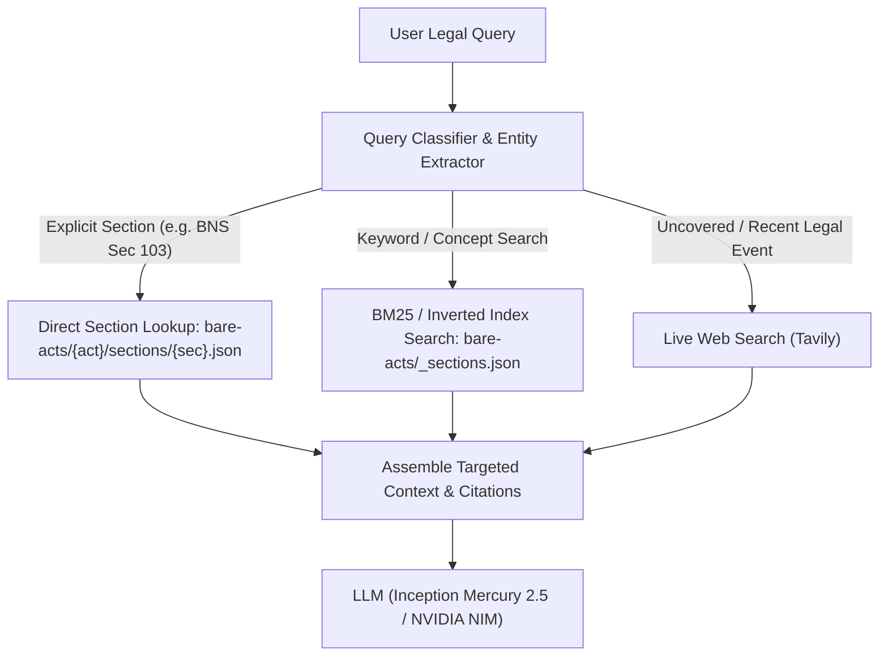

# Knowledge Base (KB) Architecture & Indexing Guide

This document outlines the organization, ingestion pipeline, and retrieval architecture for LawBite's Indian legal knowledge base.

---

## 1. Directory Structure

The `knowledge-base/` folder is partitioned by content type:

```text
knowledge-base/
├── bare-acts/                   # Core statutory corpus
│   ├── _index.json              # Catalog of all ingested acts (id, title, year, sectionCount)
│   ├── bharatiya-nyaya-sanhita/
│   │   ├── _sections.json       # Table of contents: section numbers, titles, startLine
│   │   ├── full.txt             # Authoritative plain text of the full act
│   │   └── sections/            # Granular section JSONs for direct, low-latency fetch
│   │       ├── 1.json
│   │       ├── 2.json
│   │       └── ...
│   └── code-of-civil-procedure/
│       ├── _sections.json
│       ├── full.txt
│       └── sections/
├── case-law/                    # Landmark judgments & precedents
│   ├── supreme-court/
│   └── high-courts/
├── reference/                   # Mappings, cross-references, transition tables
│   ├── bns-to-ipc.json          # Concordance between old and new criminal codes
│   ├── bnss-to-crpc.json
│   └── bsa-to-iea.json
├── templates/                   # Standard Indian legal notices & drafts
│   ├── cheque-bounce-notice.md
│   ├── eviction-notice.md
│   └── rti-application.md
└── indices/                     # Pre-computed search indices
    ├── bm25-terms.json          # Inverted index for statutory title & keyword lookup
    └── embeddings-manifest.json # Vector index metadata (model, chunk ids)
```

---

## 2. Granular Retrieval Without Loading Hundreds of Files

Loading entire statutes into the AI prompt overflows context windows, degrades inference speed, and introduces hallucination. Instead, LawBite uses a **two-tier hierarchical retrieval strategy**:



### Retrieval Tiers:
1. **Tier 1: Direct Section Retrieval (`O(1)`)**
   - When the user mentions a specific provision (e.g., *"Section 103 BNS"* or *"Article 21"*), the system uses `ACT_MAP` + section number to read only that 1–2 KB JSON file directly (`sections/103.json`).
2. **Tier 2: Inverted Index & Semantic Metadata (`O(K)`)**
   - For topical questions (e.g., *"punishment for rash driving"*), the system searches the lightweight `_sections.json` metadata index across acts rather than reading megabytes of raw text.
3. **Tier 3: In-Memory LRU Cache**
   - Frequent statutes and sections are cached in application memory (`lib/s3.ts`), eliminating file system I/O on repeated queries.

---

## 3. Recommended Open-Source Indexing Tools & Vector RAG

If you expand the knowledge base to tens of thousands of case-law judgments:

1. **pgvector in PostgreSQL (Neon)** *(Recommended)*
   - **Why:** LawBite already uses Neon PostgreSQL. You can enable `pgvector` directly without running additional infrastructure.
   - **How:** Split documents into section-level chunks, compute embeddings (e.g. `bge-base-en-v1.5` or `text-embedding-3-small`), and retrieve via cosine similarity.
2. **Meilisearch / BM25 Inverted Index**
   - **Why:** Pure lexical search with typo tolerance and instant filtering. Ideal for finding acts by exact section number, title, or statutory phrasing.
3. **Hybrid Search (BM25 + Dense Vectors + Reciprocal Rank Fusion)**
   - Delivers the best precision for legal tech: BM25 guarantees finding the exact statute number, while embeddings handle colloquial questions.
